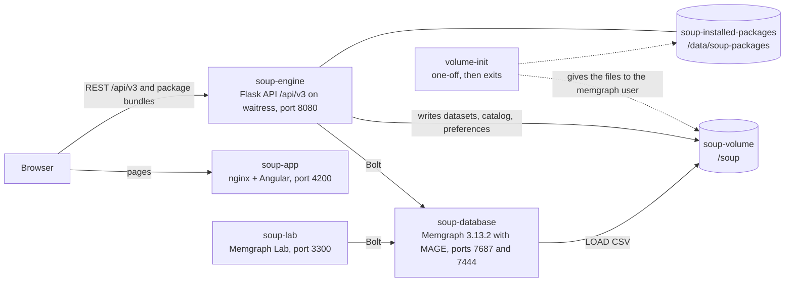
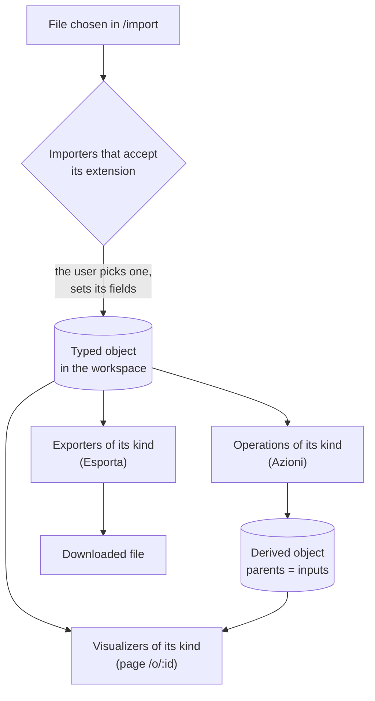

# Soup


## Description

**SOUP** is a web application for **object-centric process mining**. It reads event data, builds an
**Event Knowledge Graph (EKG)** on [Memgraph](https://memgraph.com) and lets you explore, filter,
aggregate and export it:

- **event logs in CSV**: choose which columns are the event id, the timestamp, the activity, the
  entities (objects) and the plain values; every entity becomes an `:Entity` node, linked to its
  events with `:CORR` and ordered with directly-follows `:DF` relationships;
- **OCEL 2.0 logs** (`.json`, `.jsonocel`): kept as tables, or decomposed into an EKG with the
  qualifiers of the event-object relationships and the object-object relationships (`:REL`);
- **object-centric analysis**: statistics, graph views, ready-made queries, process indicators,
  analyses with filters (time window, trace duration, activities, frequency, variants) and the
  aggregated graph of the classes of events per entity type;
- **export** of every object: the graph as JSON, analysis configurations, CSV tables, OCEL 2.0
  JSON, reports.

Everything SOUP does comes from a **package**: a folder with a feature's backend and frontend, which
can also be installed while the application runs.

The full documentation is in the [wiki](https://github.com/AlessioPiana54/soup/wiki). Example event
logs are in [soup-validation](https://github.com/soup-ocpm/soup-validation); this repository ships
[soup-app/public/help/order_process.csv](soup-app/public/help/order_process.csv) and the OCEL 2.0
file [soup-packages/ocel/tests/fixtures/orders.json](soup-packages/ocel/tests/fixtures/orders.json).

---

## Architecture

SOUP follows the plug-in model of [ProM](https://promtools.org/): a small core that only mediates,
and packages that contribute everything else.

```
soup-app/        host frontend (Angular 21): workspace, import, object page, packages page
soup-server/     host backend (Python, Flask): the core (soup/core) and the HTTP API (soup/api)
soup-packages/   the packages (server/ + app/ each) and @soup/sdk, the SDK of their frontends
```

- **The core is a mediator.** It loads the packages, registers their contributions, routes the
  requests and keeps the workspace. It does not import pandas, neo4j, docker or Flask and holds no
  Cypher: `soup-server/tests/test_architecture_boundaries.py` checks it.
- **Typed objects.** Everything in the workspace is an object `{id, name, kind, created_by,
  parents, meta}`; an object made from others lists them in `parents` (its provenance).
- **Contributions**, offered only for the objects whose kind they accept (the user chooses when
  there are several):

  | Contribution | What it does |
  |---|---|
  | Importer | Creates an object from a file (by extension). |
  | Operation | Takes objects of some kinds and produces new, derived objects. |
  | Visualizer | Shows an object: a Web Component of the package, loaded at runtime. |
  | Exporter | Writes an object to a file. |

- **Tools** are services provided by packages (Memgraph, file storage, catalog of the objects,
  preferences); a package uses only the tools it declares.
- **Extension points** let a package extend another (e.g. a build step of the EKG, a view of the
  graph, a filter of the analyses); **events** (`object.created`, `ekg.built`...) let packages react
  to each other. A package imports another only through its `api.py`, and only if it requires it.

| ProM | SOUP |
|---|---|
| Package | Package in `soup-packages/` or installed from a zip at `/packages` |
| Object pool | Workspace (`/workspace`), with the provenance of the objects |
| `@Plugin` with input/output types | Operation (inputs by kind → produced kinds) |
| Import plug-in | Importer |
| `@Visualizer` | Visualizer (`/o/:id`, chosen per kind and remembered) |
| Export plug-in | Exporter |

### Containers



### From a file to an object



### Shipped packages

| Package | Importers | Operations | Visualizers | Exporters | Tools, extension points, events |
|---|---|---|---|---|---|
| `tool_memgraph` | | | | | tool `memgraph` |
| `tool_storage` | | | | | tools `storage`, `catalog`, `preferences` |
| `soup_base` | | | Report | Report in JSON | shared elements (`soup-table`, `soup-chart`, `soup-graph-view`...) |
| `text` | Testo (`.txt`, `.md`, `.log`) | | Testo | File originale | |
| `csv_table` | CSV come tabella (`.csv`, `.tsv`) | Distribuzione di una colonna | Tabella CSV, Profilo colonne | CSV | |
| `ekg` | | Carica in Memgraph | | | points `ekg.build_steps`, `ekg.state_providers`; events `ekg.before_reset`, `ekg.built` |
| `csv_ekg` | CSV come event log (EKG su Memgraph) | Converti in EKG | | | |
| `causal_df` | | | | | build step of the causal `:DF` (order 450) |
| `ekg_views` | | | Grafo, Statistiche, Interrogazioni | JSON del grafo | points `ekg.graph_views`, `ekg.queries`, `ekg.json_parts`, `ekg.stats_notices` |
| `ekg_analysis` | | Nuova analisi, Importa configurazione di analisi, Esempio di configurazione | Indicatori di processo | Configurazione dell'analisi | point `ekg.analysis_filters` (six filters); event `analysis.before_apply` |
| `ekg_class_graph` | | Costruisci grafo aggregato | Grafo aggregato, Statistiche del grafo aggregato | | |
| `ocel` | OCEL 2.0 come tabelle, OCEL 2.0 come EKG su Memgraph | Scomponi in EKG | Tabelle OCEL, Riepilogo OCEL | OCEL 2.0 JSON | build step of the qualifiers and `:REL` (order 420) |

The user interface is in Italian: the names above are the ones it shows. Every package is described
in the [Package reference](https://github.com/AlessioPiana54/soup/wiki/Package-reference).

---

## Start the tool with Docker

Install [Git](https://git-scm.com/downloads) and [Docker](https://www.docker.com/get-started/), then:

```sh
git clone https://github.com/AlessioPiana54/soup.git
cd soup
docker compose -p soup-tool up --build
```

| Container | What it is | Access |
|---|---|---|
| **soup-app** | The frontend (nginx) | [http://localhost:4200](http://localhost:4200) |
| **soup-engine** | The backend `/api/v3` and the package bundles, on waitress (`wsgi.py`), one process with 8 threads | [http://localhost:8080](http://localhost:8080) |
| **soup-database** | Memgraph 3.13.2 with MAGE (`memgraph/memgraph-mage:3.13.2`) | `7687` (Bolt), `7444` |
| **soup-lab** | Memgraph Lab (`memgraph/lab:3.13.2`) | [http://localhost:3300](http://localhost:3300) |
| **volume-init** | One-off: gives the files of the volumes to the user of the backend and of Memgraph, then exits | |

The datasets, the catalog of the objects and the preferences are files in the `soup-volume`
volume, mounted on `/soup` in the backend (which writes them) and in Memgraph (which reads the CSVs
with `LOAD CSV`). The packages installed at runtime are in `soup-installed-packages`. Both survive a
rebuild; the graph is rebuilt from the dataset files when an object is opened.

The backend runs as an unprivileged user with the UID and GID of the `memgraph` user of the Memgraph
image (101 and 103 in 3.13.2):

```sh
docker run --rm --entrypoint id memgraph/memgraph-mage:3.13.2 memgraph
```

`volume-init` runs before the backend at every `up`: it changes the owner of the files of the two
volumes that belong to someone else (for example volumes written by older versions, as root) and
removes or moves nothing. To run it by hand:

```sh
docker compose -p soup-tool run --rm volume-init
```

### Backup and restore of the volumes

```sh
# backup: one archive per volume in ./backup
docker run --rm -v soup-tool_soup-volume:/data -v "$PWD/backup":/backup alpine tar czf /backup/soup-volume.tgz -C /data .
docker run --rm -v soup-tool_soup-installed-packages:/data -v "$PWD/backup":/backup alpine tar czf /backup/soup-installed-packages.tgz -C /data .
tar tzf backup/soup-volume.tgz | head   # check that the archive can be read

# restore (with the stack stopped: docker compose -p soup-tool down)
docker run --rm -v soup-tool_soup-volume:/data -v "$PWD/backup":/backup alpine sh -c "tar xzf /backup/soup-volume.tgz -C /data"
```

On Windows use a full path (`-v C:\Users\me\backup:/backup`); in Git Bash prefix the commands with
`MSYS_NO_PATHCONV=1`.

### `vm.max_map_count`

At startup Memgraph may log `vm.max_map_count 262144 is too low, increase to at least 524288`. It
is a setting of the Linux kernel that runs Docker. On Docker Desktop for Windows (WSL2):

```sh
wsl -d docker-desktop sysctl vm.max_map_count                # the current value
wsl -d docker-desktop sysctl -w vm.max_map_count=524288      # only if it is lower
```

It lasts until WSL restarts; to keep it, add `kernelCommandLine = sysctl.vm.max_map_count=524288`
under `[wsl2]` in `%UserProfile%\.wslconfig` and run `wsl --shutdown`. On Linux:
`sudo sysctl -w vm.max_map_count=524288` (permanent in `/etc/sysctl.conf`).

### Pages

| Page | What it does |
|---|---|
| `/welcome` | The state of the tools. |
| `/import` | Choose a file and an importer, set its fields, see the preview, import. |
| `/workspace` | The objects with their provenance: search, filter by kind and package, rename and describe, delete. |
| `/o/:id` | One object: its visualizers, its operations (**Azioni**) and its exporters (**Esporta**). |
| `/packages` | Install a package from a zip, enable, disable and remove packages. |

---

## Local development

Node **24.22.0** or later with npm 11 (`.nvmrc`), Python **3.12** (3.10 is supported too).

```sh
# backend: a virtual environment with the libraries of the image and the dev tools
cd soup-server
python -m venv .venv
source .venv/Scripts/activate     # Git Bash on Windows; Linux and macOS: source .venv/bin/activate
pip install -r requirements-dev.txt

# packages: the SDK and the frontend bundles of every package
cd ../soup-packages
npm ci
npm run build:packages

# host frontend
cd ../soup-app
npm ci
```

To work on the frontend against the backend of the Docker stack, stop its frontend and start the
development server on the same port (the frontend calls the backend at `http://127.0.0.1:8080`):

```sh
docker compose -p soup-tool stop angular
cd soup-app && npm start          # ng serve on http://localhost:4200
```

To run the backend from the sources, stop its container and start `app.py` (the Flask development
server) against the Memgraph of the stack. Outside Docker the backend cannot share the `/soup`
volume, so it writes the datasets into the Memgraph container through the Docker API
(`SOUP_STORAGE_KIND=docker`, the Docker of your machine); the next `docker compose up` gives the
files it wrote back to the `memgraph` user:

```sh
docker compose -p soup-tool stop flask
cd soup-server
MEMGRAPH_HOST=localhost SOUP_STORAGE_KIND=docker python app.py
```

`SOUP_DEBUG=1` turns on Flask's debug mode (never on a reachable port, see
[Security](#security)).

---

## Tests and continuous integration

```sh
# backend and the Python tests of the packages (FakeDatabase and in-memory storage: no Docker)
cd soup-server
python -m pytest
python scripts/lint.py            # ruff, vulture, mypy --strict on soup/ and every package's server/

# packages: eslint, knip, tsc; unit tests (Vitest, jsdom); bundles
cd ../soup-packages
npm run lint && npm test && npm run build:packages

# host frontend: lint, unit tests (Vitest, jsdom), build, end to end (Playwright, with Chrome)
cd ../soup-app
npm run lint && npm run test:v3 && npm run build && npm run e2e
```

The end-to-end tests start their own backend (`python -m tests.e2e_server` in `soup-server`) with
the `python` on the `PATH`: activate the virtual environment first. The smoke tests of `ekg_views`
and `ekg_analysis` run every query against a real Memgraph (their READMEs).

The same checks run on GitHub Actions at every push and pull request
([.github/workflows/README.md](.github/workflows/README.md)): backend on Python 3.10 and 3.12,
packages, frontend with the end-to-end tests, the Memgraph smoke tests and the build of the two
images. More in [Testing and CI](https://github.com/AlessioPiana54/soup/wiki/Testing-and-CI).

---

## Environment variables

| Variable | Default | Read by | Meaning |
|---|---|---|---|
| `SOUP_PACKAGES` | absent: every package found | host | Comma-separated packages to activate at startup (empty: none). |
| `SOUP_PACKAGES_PATH` | `soup-packages/` + installed dir | host | Folders where packages are searched (`os.pathsep`-separated). |
| `SOUP_INSTALLED_PACKAGES_DIR` | `soup-server/instance/packages` (image: `/data/soup-packages`) | host | Where installed zips are extracted and the enabled/disabled state is kept. |
| `SOUP_ALLOW_PACKAGE_INSTALL` | `false` (`true` in `docker-compose.yaml`) | host | Allows installing and uninstalling packages at runtime. |
| `SOUP_STRICT` | `false` | host | A package that fails to load stops the startup. |
| `SOUP_MAX_UPLOAD_MB` | `200` | host | Maximum request body of `/api/v3` (413 above). |
| `SOUP_DEBUG` | `false` | `app.py` only | `1` or `true`: Flask debug mode. |
| `MEMGRAPH_HOST`, `MEMGRAPH_PORT` | `memgraph`, `7687` | `tool_memgraph` | Memgraph connection. |
| `SOUP_STORAGE_KIND` | `docker` (`local` in `docker-compose.yaml`) | `tool_storage` | `local`: files under `SOUP_LOCAL_STORAGE_ROOT`; `docker`: files written into the Memgraph container through the Docker API. |
| `SOUP_LOCAL_STORAGE_ROOT` | `/soup` | `tool_storage` | Root of the `local` storage, the same path Memgraph reads with `LOAD CSV`. |
| `SOUP_CONTAINER_NAME` | `soup-database` | `tool_storage` | Container of the `docker` storage. |
| `SOUP_EKG_VIEWS_MAX_LIMIT` | `2000` | `ekg_views` | Maximum number of graph elements drawn. |
| `SOUP_TEXT_CACHE_OBJECTS`, `SOUP_TEXT_CACHE_MB` | `8`, `200` | `text` | In-memory cache of the decoded files. |
| `SOUP_CSV_TABLE_CACHE_OBJECTS`, `SOUP_CSV_TABLE_CACHE_MB` | `8`, `200` | `csv_table` | In-memory cache of the parsed tables. |
| `SOUP_OCEL_CACHE_OBJECTS`, `SOUP_OCEL_CACHE_MB` | `8`, `200` | `ocel` | In-memory cache of the tables of the OCEL logs. |

---

## Security

- **Installing a package runs its code** with the privileges of the server (its `server/` part) and
  of the browser (its `app/` part). Installation is off by default
  (`SOUP_ALLOW_PACKAGE_INSTALL=false`, then install and uninstall answer `403`); the development
  `docker-compose.yaml` turns it on: turn it off for a shared deployment. Zips are validated before
  any code is imported (size, paths, symbolic links, manifest, `api_version`,
  `python_dependencies`, `requires`); only a package's `app/dist` is served to the browser.
- **The backend has no access to the Docker daemon.** `docker-compose.yaml` does not mount the
  Docker socket and the backend runs as an unprivileged user. Whoever controls the Docker socket
  controls the host; the `docker` storage (`SOUP_STORAGE_KIND=docker`) needs it and is meant for
  local development only.
- **`SOUP_DEBUG` is for local development only:** the Werkzeug debugger runs Python code for
  whoever reaches the port. `wsgi.py`, used by the image, never reads it.
- **Package code** reaches only the tools it declares, sends Cypher as a parameterized `Query`,
  quotes identifiers with `ident()` and never puts user values in the text of a query.

---

## Known limitations

- **One process, one graph.** The engine keeps its state in memory: run one process (waitress
  with threads), never several workers. Memgraph holds one graph at a time: opening another EKG
  rebuilds its graph from the dataset files.
- **The frontend calls the backend at `http://127.0.0.1:8080`.** The production build uses
  `src/environments/environment.ts`, so the application works from the machine that runs the
  stack; the `/api/` proxy in `soup-app/nginx.conf` points at `localhost:8080` inside the frontend
  container and does not reach the backend.
- **Legacy datasets** whose configuration uses one column for two of the roles event id, timestamp
  and activity cannot be built: their object shows why.
- **EKGs imported from OCEL before the relationships entered the graph** have neither the
  qualifiers nor `:REL` until the file is imported again (or decomposed again from its tables);
  their statistics say so.
- **Timestamps** must be in a format Memgraph's `localDateTime` reads: `YYYY-MM-DDThh:mm:ss[.mmm]`,
  `YYYY-MM-DDThh:mm`, `YYYYMMDDThhmmss`, `YYYYMMDDThhmm` or `YYYYMMDDThh`.
- **The graph view** draws at most `SOUP_EKG_VIEWS_MAX_LIMIT` elements (2000 by default).

---

## Credits

- **Original author:** Alessio Giacché.
- **Contributors:** Sara Pettinari; research activities with Lorenzo Rossi.
- **Plugin architecture, package system and v3 API by Alessio Pianaroli (2026):**
  - the core as a mediator of typed objects, contributions, tools, extension points and events;
  - the package system: manifests, loading, runtime installation from zips, frontends as Web
    Components with `@soup/sdk`;
  - the `/api/v3` HTTP API and the new host pages (import, workspace, object page, packages);
  - the EKG, OCEL, analysis, views and aggregated-graph packages, with the relationships of OCEL
    2.0 in the graph;
  - the backend without access to Docker, the test suites and the continuous integration.

The original project is [soup-ocpm/soup](https://github.com/soup-ocpm/soup). SOUP is released under
the [MIT License](LICENSE).

> 💭 Our tool is called _Soup_, with a logo showcasing a mix of rainbow noodles, symbolizing the
> dynamic and interconnected flow of object-centric process mining, much like the iconic image of
> rainbow spaghetti.
